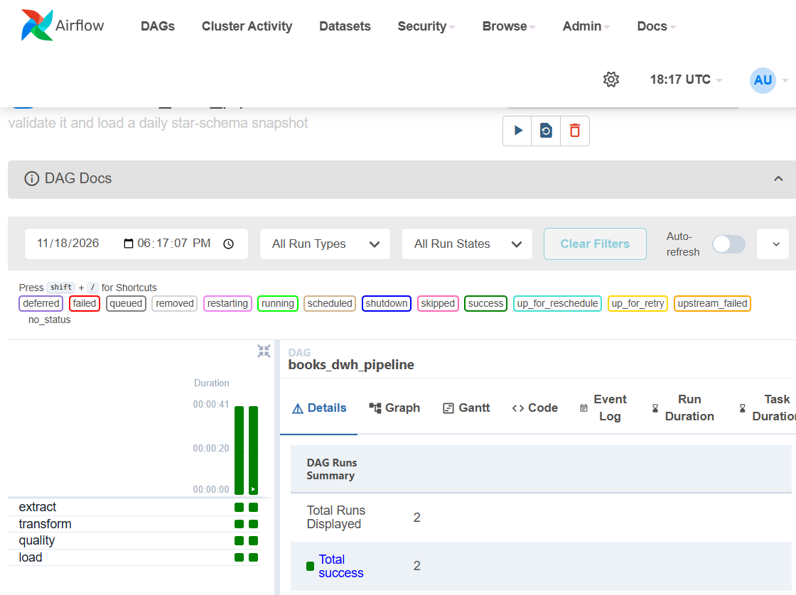

# Books Data Warehouse Pipeline

A small, production-shaped data engineering project: **scrape → Airflow → PostgreSQL star schema → data quality gates → tests & CI**.

It crawls [books.toscrape.com](https://books.toscrape.com) (a sandbox built for scraping practice), keeps **one fact row per book per day**, and therefore tracks how prices, availability and ratings change over time.


> Repository: [AhmedSaidRR/books-dwh-pipeline](https://github.com/AhmedSaidRR/books-dwh-pipeline)

## What it does

Every day the `books_dwh_pipeline` DAG runs four steps:

| Step | Module | What happens |
| --- | --- | --- |
| **Extract** | `src/scraper.py` | `BooksScraper` crawls all 50 categories, follows pagination, retries failed HTTP calls and writes raw JSON. |
| **Transform** | `src/transform.py` | pandas: parses prices, normalises ratings/booleans, derives `price_tier`, de-duplicates on the natural key, writes parquet. |
| **Quality** | `src/quality.py` | 10 critical rules + 1 warning rule. A critical failure **fails the Airflow task and blocks the load**. |
| **Load** | `src/load.py` | Idempotent upsert into the `dim_date` / `dim_book` / `dim_category` / `fact_book_snapshot` star schema. |

```
 books.toscrape.com
         │  requests + BeautifulSoup (class BooksScraper)
         ▼
   data/raw/books_YYYY-MM-DD.json
         │  pandas
         ▼
 data/processed/books_YYYY-MM-DD.parquet
         │  DataQualityValidator
         ▼
   PostgreSQL 16  ──  dim_date ─┐
   localhost:5433  dim_book ────┼── fact_book_snapshot
                   dim_category ┘
```

## Star schema

Grain of the fact table: **one row per book per snapshot date**.

```
        dim_date                     dim_category
  ┌──────────────────┐         ┌────────────────────┐
  │ date_key (PK)    │         │ category_key (PK)  │
  │ full_date        │         │ category_name      │
  │ day/week/month/  │         └─────────┬──────────┘
  │ quarter/year     │                   │
  │ is_weekend       │                   │
  └────────┬─────────┘                   │
           │                             │
           │     fact_book_snapshot      │
           │  ┌───────────────────────┐  │
           └─▶│ date_key (FK)         │  │
              │ book_sk (FK)          │◀─┘
              │ price_gbp             │
              │ price_tier            │
              │ rating                │
              │ in_stock              │
              │ run_id, loaded_at     │
              │ UNIQUE(date_key,book) │
              └───────────▲───────────┘
                          │
                    dim_book (book_sk PK,
                    book_key UNIQUE, title,
                    category_key FK, URLs,
                    first_seen / last_seen)
```

* `book_key` is the **natural key** taken from the URL slug (`a-light-in-the-attic_1000`). Titles can be edited, prices change daily; the slug is stable.
* `book_sk` is the **surrogate key** used by the fact table, so the fact table stays narrow and joins stay fast.
* `etl_run_log` records every run (`running/success/failed`, row counts, duration) for observability.

Full DDL: [`sql/init_warehouse.sql`](sql/init_warehouse.sql).

## Quick start

Requirements: Docker Desktop (or Docker Engine + Compose v2).

```bash
cp .env.example .env      # Windows cmd: copy .env.example .env
docker compose up -d --build
```

Then:

1. Open <http://localhost:8080> and log in with **admin / admin**.
2. Unpause the `books_dwh_pipeline` DAG and press **Trigger**.
3. Watch the four tasks turn green (~1–2 minutes for the full catalogue).

The warehouse is exposed on **port 5433** (not 5432, to avoid clashing with a local PostgreSQL):

```bash
docker compose exec warehouse psql -U warehouse -d warehouse
```

```sql
SELECT c.category_name,
       COUNT(*)                     AS books,
       ROUND(AVG(f.price_gbp), 2)   AS avg_price,
       COUNT(*) FILTER (WHERE f.in_stock) AS in_stock
FROM fact_book_snapshot f
JOIN dim_book b     ON b.book_sk = f.book_sk
JOIN dim_category c ON c.category_key = b.category_key
JOIN dim_date d     ON d.date_key = f.date_key
WHERE d.full_date = (SELECT MAX(full_date) FROM dim_date)
GROUP BY c.category_name
ORDER BY avg_price DESC
LIMIT 10;
```

## Results

Measured on **18 Nov 2026** with a full crawl from the machine that built this repo:

| Metric | Value |
| --- | --- |
| Categories crawled | **50** |
| HTTP requests (category pages + pagination) | ~100 |
| Unique books extracted | **1 000** |
| Extract + transform duration (local CLI) | **63 s** |
| Airflow DAG runs | **2** (2026-11-17 scheduled, 2026-11-18 manual) — **4/4 tasks green** in both |
| Task durations in Airflow | extract **35 s**, transform **1.0 s**, quality **0.6 s**, load **1.1 s** |
| Quality checks passed | **10 critical / 11 total** (1 warning: 2 placeholder categories in the source) |
| Rows after both runs | **2 000 fact rows** (1 000 books × 2 days), 1 000 books, 50 categories |
| Load duration (parquet → PostgreSQL) | **0.63 s** locally, **1.1 s** in Airflow |
| Re-run of the same date | still **1 000** rows for that date (idempotent upsert) |
| Unit tests | **47 passed** |

Top 5 most expensive books in the snapshot:

```
               title                |   category_name    | price_gbp | rating | in_stock | full_date
------------------------------------+--------------------+-----------+--------+----------+------------
 The Perfect Play (Play by Play #1) | Romance            |     59.99 |      3 | t        | 2026-11-18
 Last One Home (New Beginnings #1)  | Fiction            |     59.98 |      3 | t        | 2026-11-18
 Civilization and Its Discontents   | Psychology         |     59.95 |      2 | t        | 2026-11-18
 The Barefoot Contessa Cookbook     | Food and Drink     |     59.92 |      5 | t        | 2026-11-18
 The Diary of a Young Girl          | Nonfiction         |     59.90 |      3 | t        | 2026-11-18
```

> The warehouse really contains two daily snapshots, so the `LAG()` query returns
> 1 000 comparisons. Prices are identical across the two runs because
> books.toscrape.com is a static sandbox (the runs happened minutes apart), so
> `price_change` is `0.00`. On a live store the same query produces the daily
> price movement.



## Project structure

```
.
├── dags/
│   └── books_pipeline.py        # TaskFlow DAG: extract → transform → quality → load
├── src/
│   ├── config.py                # env-driven settings (scraper + database)
│   ├── scraper.py               # BooksScraper (OOP, pagination, retries)
│   ├── transform.py             # pandas cleaning + enrichment
│   ├── quality.py               # data contract checks
│   ├── load.py                  # idempotent star-schema upsert
│   └── pipeline.py              # local CLI runner (same functions as Airflow)
├── sql/
│   ├── init_warehouse.sql       # DDL, constraints and indexes
│   └── analytics_queries.sql    # LAG / RANK / category health / observability
├── tests/                       # 47 unit tests + 1 PostgreSQL integration test
├── .github/workflows/ci.yml     # ruff + pytest + postgres integration job
├── docker-compose.yml           # Airflow (LocalExecutor) + metadata DB + warehouse
├── Dockerfile                   # Airflow image with pinned pipeline deps
├── requirements.txt / requirements-dev.txt
└── .env.example
```

## Data quality rules

| Check | Severity | Why |
| --- | --- | --- |
| `required_columns` | critical | the transform contract changed |
| `row_volume` | critical | catches a truncated crawl; minimum scales with the number of categories (8 books/category) |
| `book_key_unique` | critical | the fact table grain depends on it |
| `no_nulls_in_key_columns` | critical | no measures/keys may be null |
| `rating_between_1_and_5` | critical | the star rating is 1..5 by definition; a 9 means parsing or scraping broke |
| `price_within_bounds` | critical | prices must be in `(0, 1000)` GBP |
| `price_tier_valid` | critical | only `budget / standard / premium` |
| `in_stock_is_boolean` | critical | boolean contract for the warehouse |
| `categories_present` | critical | every row needs a category |
| `snapshot_date_matches_run` | critical | guards against loading data under the wrong date |
| `category_not_placeholder` | warning | the source really contains `Default` and `Add a comment` categories; a warning keeps the load green but visible |

The database is a second line of defence: `CHECK (rating BETWEEN 1 AND 5)`, `CHECK (price_gbp > 0)` and `UNIQUE (date_key, book_sk)`.

### Break it on purpose

This is the quickest way to see the quality gate work:

```bash
# flip one rating to 9 in a copy of the raw payload
python -c "import json;d=json.load(open('data/raw/books_2026-11-18.json'));d[0]['rating']=9;json.dump(d,open('data/raw/books_broken.json','w'))"

python -m src.pipeline --snapshot-date 2026-11-18 \
  --raw-file data/raw/books_broken.json --skip-load
```

Actual output:

```
Quality report: 1000 rows, snapshot=2026-11-18, FAILED
  [FAIL] rating_between_1_and_5: 1 out-of-range ratings, e.g. [...]
ERROR __main__ - Pipeline failed: data quality checks failed: rating_between_1_and_5
```

Exit code is `1`, the parquet file is still written for debugging, and **nothing is loaded**. In Airflow the same row makes the `quality` task fail; because that task has `retries=0`, the run stops instead of retrying a deterministic bug.

## Run locally (without Airflow)

```bash
python -m venv .venv
source .venv/bin/activate            # Windows: .venv\Scripts\activate
pip install -r requirements-dev.txt

cp .env.example .env                 # Windows: copy .env.example .env

# quick run: two categories, no database needed
python -m src.pipeline --max-categories 2 --skip-load

# full run into the compose warehouse (start it first: docker compose up -d warehouse)
python -m src.pipeline

# replay a stored raw file without touching the network
python -m src.pipeline --raw-file data/raw/books_2026-11-18.json
```

Useful flags: `--snapshot-date YYYY-MM-DD`, `--max-categories N`, `--skip-load`, `--run-id ID`.

## Tests & CI

```bash
pytest -m "not integration" -v        # 47 unit tests, no network / no DB
ruff check .
```

`tests/` covers price/rating/availability parsing, pagination, de-duplication, every transform rule, every quality rule (including the rating-9 failure), the date dimension, and the schema contract.

The integration test in `tests/test_load_integration.py` runs against a real PostgreSQL instance (in CI it uses a `postgres:16` service container):

```bash
docker compose up -d warehouse
RUN_DB_TESTS=1 pytest -m integration -v
```

CI (`.github/workflows/ci.yml`) runs three gates on every push/PR: **ruff lint**, **DAG compile check**, **unit tests with coverage**, plus the **PostgreSQL integration job**.

## SQL worth showing in an interview

Top 3 most expensive books per category (`RANK`):

```sql
WITH ranked AS (
    SELECT c.category_name, b.title, f.price_gbp,
           RANK() OVER (PARTITION BY c.category_name ORDER BY f.price_gbp DESC) AS price_rank
    FROM fact_book_snapshot f
    JOIN dim_book b     ON b.book_sk = f.book_sk
    JOIN dim_category c ON c.category_key = b.category_key
    JOIN dim_date d     ON d.date_key = f.date_key
    WHERE d.full_date = (SELECT MAX(full_date) FROM dim_date)
)
SELECT * FROM ranked WHERE price_rank <= 3 ORDER BY category_name, price_rank;
```

Price change versus the previous snapshot (`LAG`):

```sql
SELECT b.title, d.full_date, f.price_gbp,
       LAG(f.price_gbp) OVER (PARTITION BY b.book_sk ORDER BY d.full_date) AS previous_price,
       ROUND(f.price_gbp - LAG(f.price_gbp) OVER (PARTITION BY b.book_sk ORDER BY d.full_date), 2) AS change
FROM fact_book_snapshot f
JOIN dim_book b ON b.book_sk = f.book_sk
JOIN dim_date d ON d.date_key = f.date_key
ORDER BY change ASC NULLS LAST;
```

More in [`sql/analytics_queries.sql`](sql/analytics_queries.sql).

## Design decisions (and the questions they answer)

* **Why a class for the scraper?** Parsing (`parse_categories`, `parse_books`), HTTP (`fetch`) and crawling (`scrape_category`, `scrape`) are separate responsibilities; the parsing methods are static and unit-testable without a network, and the session is injectable (tests use a fake session).
* **Why crawl categories instead of detail pages?** The listing page does not contain the category, but the *page context* does. Crawling 50 category feeds (~100 requests) replaces 1 000 detail-page requests and keeps the category attribute exact.
* **Why star schema?** The fact table is narrow (one row/book/day) and the dimensions carry the descriptive text. Category averages, price history and per-book day-over-day changes are simple joins + window functions.
* **Why is the load idempotent?** Airflow retries and manual re-runs are normal. `UNIQUE (date_key, book_sk)` + `ON CONFLICT DO UPDATE` makes a re-run a repair, not a duplicate.
* **Why does `quality` have `retries=0`?** Network errors are transient (retry), data bugs are deterministic (fail fast). Retrying a rating of 9 would only waste slots and delay the alert.
* **Why are some checks warnings?** Not every anomaly should stop the business. The source contains two placeholder categories; surfacing them as a warning keeps the daily load honest without paging someone at 3 a.m.
* **Why store ratings in the fact table?** Rating is a snapshot measure, not a fixed book attribute — it can change and must be analysable over time. `dim_book` only holds slowly changing descriptive attributes (title, category, URLs).

## Troubleshooting

| Symptom | Fix |
| --- | --- |
| `port is already allocated` | PostgreSQL 5432 is already in use locally; the warehouse publishes **5433**. Change `POSTGRES_PORT` in `.env` if needed. |
| Tables missing after changing the schema | Init scripts only run on an empty volume: `docker compose down -v && docker compose up -d --build` (destroys data). |
| DAG not visible | `docker compose logs airflow-scheduler` — wait for the 30 s DAG refresh, then reload the UI. |
| Scraper timeout / HTTP 503 | The site is rate-limited sometimes; the scraper retries with backoff. Re-trigger the task. |
| `docker compose build` fails on a dependency | The Dockerfile pins Airflow 2.10.5 constraints; check `requirements.txt` versions against `constraints-2.10.5`. |
| Airflow UI asks for a login | `admin` / `admin` (created by `airflow-init`, local only). |

## Roadmap

* [ ] Keep the DAG running for a week so `LAG()` shows real price movements (the sandbox catalogue is static).
* [ ] SCD Type 2 for `dim_book` (track category/title changes with `valid_from` / `valid_to`).
* [ ] dbt models on top of the star schema + tests.
* [ ] Great Expectations instead of (or alongside) the hand-written checks.
* [ ] Streamlit dashboard: average price per category, biggest daily drops, stock ratio.

## Data & legal note

`books.toscrape.com` is a public sandbox explicitly created for scraping practice. The scraper still behaves politely: one request at a time, a configurable delay, a descriptive User-Agent, retries with exponential backoff, and no login-bypassing or personal data collection.
